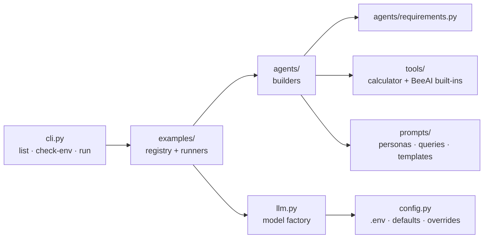
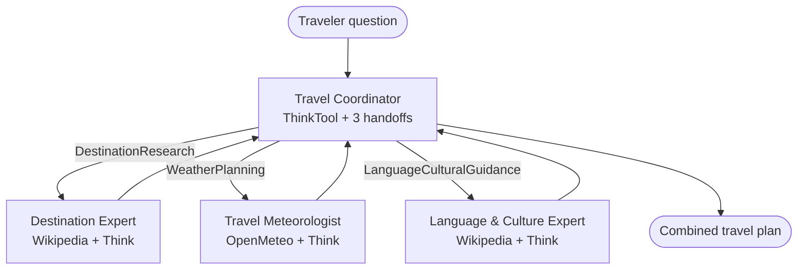

# BeeAI Agentic Lab

**From a single chat call to a multi-agent system, built with the [BeeAI Framework](https://github.com/i-am-bee/beeai-framework).**

> [!IMPORTANT]
> **Credit:** this project is a **modular refactor of existing IBM course material, not original work.**
> The code, prompts, agent designs and lab guide come from the IBM Skills Network hands-on lab
> **"Building Agentic AI Systems with the BeeAI Framework"** by **Wojciech "Victor" Fulmyk**, part of the
> **[IBM RAG and Agentic AI Professional Certificate](https://www.coursera.org/professional-certificates/ibm-rag-and-agentic-ai)**.
> The original code base was already published on GitHub. Original material © IBM Corporation, licensed under Apache 2.0.
> My contribution is the restructuring, tooling and documentation described in
> [What changed from the original lab](#what-changed-from-the-original-lab). See [Credits and license](#credits-and-license) and [`NOTICE`](NOTICE).

---

## Contents

- [What this project does](#what-this-project-does)
- [The learning path](#the-learning-path)
- [Project structure](#project-structure)
- [Components](#components)
- [Setup](#setup)
- [Usage](#usage)
- [Extending the project](#extending-the-project)
- [Testing](#testing)
- [Troubleshooting](#troubleshooting)
- [What changed from the original lab](#what-changed-from-the-original-lab)
- [Credits and license](#credits-and-license)

---

## What this project does

The lab teaches the BeeAI Framework step by step, in twelve stages. It starts with a single call to a language model. It ends with a team of AI agents that plan a trip together. Each stage adds one concept:

1. **Talk to a model** with `ChatModel` (IBM Granite on watsonx.ai)
2. **Reuse prompts** with templates
3. **Get typed data back** with Pydantic schemas (OpenAI GPT-5 nano)
4. **Build an agent** with `RequirementAgent` (Meta Llama 4 Maverick on watsonx.ai)
5. **Give it tools** (Wikipedia search, a thinking scratchpad, weather data, a custom calculator)
6. **Control how it uses them** with *requirements*: order, limits and human approval
7. **Make agents work together** with `HandoffTool`

The original lab had twelve standalone scripts (`t1.py` to `t12.py`) with a lot of repeated code. This version organizes the same behavior into a Python package. You run every stage from one command-line tool, and the pieces (models, prompts, tools, agents) can be reused in your own projects.

The project uses three model families on purpose, to show that BeeAI is provider-agnostic: **IBM Granite** and **Meta Llama** on watsonx.ai, and **OpenAI GPT**.

---

## The learning path

| # | Name (`run` target) | Lab file | Concept introduced | Model |
|---|---|---|---|---|
| 01 | `environment` | `t1.py` | Credentials and model configuration | — |
| 02 | `basic-chat` | `t2.py` | `ChatModel.create()` with system + user messages | Granite |
| 03 | `prompt-templates` | `t3.py` | Reusable `{{variable}}` prompt templates | Granite |
| 04 | `structured-output` | `t4.py` | `create_structure()` + Pydantic schema | GPT-5 nano |
| 05 | `minimal-agent` | `t5.py` | `RequirementAgent` with memory, no tools | Llama 4 |
| 06 | `research-agent` | `t6.py` | `WikipediaTool` + trajectory middleware | Llama 4 |
| 07 | `reasoning-agent` | `t7.py` | `ThinkTool` for explicit reasoning | Llama 4 |
| 08 | `controlled-agent` | `t8.py` | `ConditionalRequirement`: order and limits | Llama 4 |
| 09 | `react-agent` | `t9.py` | ReAct: think before and after every tool call | Llama 4 |
| 10 | `secure-agent` | `t10.py` | `AskPermissionRequirement` (human in the loop) | Llama 4 |
| 11 | `calculator-agent` | `t11.py` | Writing your own `Tool` | Llama 4 |
| 12 | `travel-planner` | `t12.py` | Multi-agent coordination with `HandoffTool` | Llama 4 |

Examples 05–10 use **the same analyst persona and the same question** (quantum computing risks for banks). Only the agent's capabilities change, so you can compare their answers directly.

---

## Project structure

```text
beeai-agentic-lab/
├── beeai_lab/                    # the package
│   ├── __main__.py               # enables `python -m beeai_lab`
│   ├── cli.py                    # command-line interface (list / check-env / run)
│   ├── config.py                 # env defaults, model selection, credential checks
│   ├── llm.py                    # ChatModel factory (one place to create models)
│   ├── schemas.py                # Pydantic output schemas (BusinessPlan)
│   ├── prompts/
│   │   ├── templates.py          # SimplePromptTemplate ({{variable}} syntax)
│   │   ├── system_prompts.py     # every agent persona / system instruction
│   │   └── queries.py            # default user questions and scenarios
│   ├── tools/
│   │   ├── arithmetic.py         # safe AST-based math evaluator (no BeeAI dependency)
│   │   └── calculator.py         # SimpleCalculatorTool (custom BeeAI Tool)
│   ├── agents/
│   │   ├── base.py               # build_agent(): shared RequirementAgent factory
│   │   ├── requirements.py       # reusable requirement sets (sections 6-10)
│   │   ├── cybersecurity.py      # analyst agent in 6 capability levels
│   │   ├── math_assistant.py     # agent using the calculator tool
│   │   └── travel.py             # 3 specialists + coordinator (multi-agent)
│   ├── examples/                 # one runnable example per lab section
│   │   ├── __init__.py           # registry: id / slug / lab file -> runner
│   │   ├── base.py               # Example and ExampleOptions types
│   │   ├── environment.py        # 01
│   │   ├── chat.py               # 02, 03
│   │   ├── structured.py         # 04
│   │   ├── analyst.py            # 05-10
│   │   ├── calculator.py         # 11
│   │   └── travel.py             # 12
│   └── utils/
│       ├── console.py            # consistent terminal output
│       ├── errors.py             # root-cause + actionable hints for common failures
│       └── runtime.py            # logging and debug switches
├── tests/                        # offline tests (no API keys needed)
├── original_lab/                 # IBM's original t1.py–t12.py, unmodified, for reference
│   └── requirements-lab-freeze.txt   # full pip freeze of the lab environment
├── .env.example                  # template for local credentials
├── requirements.txt              # minimal runtime dependencies
├── requirements-dev.txt          # + pytest
├── pyproject.toml                # installable package, `beeai-lab` command
├── LICENSE                       # Apache 2.0
└── NOTICE                        # attribution and list of modifications
```

---

## Components

### How the layers fit together



Dependencies flow one way, left to right. `examples` uses `agents`, and `agents` uses `tools` and `prompts`. Nothing imports `examples` or `cli`. So you can import any builder into your own code without pulling in the CLI.

### `config.py`: configuration
- Loads `.env` (if present) and sets `WATSONX_PROJECT_ID=skills-network` **only if it isn't already set**. This replaces `t1.py`.
- Defines the three model roles and their defaults. Each can be overridden with an environment variable:

  | Role | Used by | Default | Override |
  |---|---|---|---|
  | `chat` | 02, 03 | `watsonx:ibm/granite-4-h-small` | `BEEAI_CHAT_MODEL` |
  | `structured` | 04 | `openai:gpt-5-nano` | `BEEAI_STRUCTURED_MODEL` |
  | `agent` | 05–12 | `watsonx:meta-llama/llama-4-maverick-17b-128e-instruct-fp8` | `BEEAI_AGENT_MODEL` |

- Uses `temperature=0` for determinism, **except for GPT-5 models**, which only accept their default temperature.

### `llm.py`: model factory
`create_chat_model()`, `chat_llm()`, `structured_llm()` and `agent_llm()` are the only places a `ChatModel` is created. Switching providers is a configuration change, not a code change.

### `prompts/`: personas, questions and templates
- `system_prompts.py`: every system instruction (the analyst, the math assistant, the three travel specialists and the coordinator).
- `queries.py`: the default questions and the project-evaluation scenarios.
- `templates.py`: `SimplePromptTemplate`, using `{{variable}}` placeholders.

### `schemas.py`: structured output
`BusinessPlan`, the Pydantic model that `create_structure()` fills in example 04. The field descriptions tell the model what to write in each field.

### `tools/`: custom tools
- `SimpleCalculatorTool` shows the full pattern for a BeeAI tool: a Pydantic input schema, `name`/`description` (what the LLM sees), an emitter namespace, and an async `_run()` that returns a `StringToolOutput`.
- `arithmetic.py` does the actual math. It is kept free of BeeAI so it can be tested on its own.

The built-in BeeAI tools used are `WikipediaTool`, `ThinkTool`, `OpenMeteoTool` and `HandoffTool`.

### `agents/`: agent builders
**`build_agent()`** (in `base.py`) creates every agent the same way: a `RequirementAgent` with `UnconstrainedMemory` and a `GlobalTrajectoryMiddleware` that prints each tool call as it happens.

**`requirements.py`** holds the rule sets that sections 6–10 add one by one:

| Variant | Tools | Requirement set | What the rules enforce |
|---|---|---|---|
| `minimal` (05) | none | none | Pure LLM answer |
| `research` (06) | Wikipedia | `limited_research()` | Wikipedia ≤ 2 calls |
| `reasoning` (07) | Think, Wikipedia | `limited_reasoning_and_research()` | Each tool ≤ 2 calls |
| `controlled` (08) | Think, Wikipedia | `think_then_research()` | Must think at step 1; Wikipedia only after thinking, 1–2 calls; no back-to-back thinking |
| `react` (09) | Think, Wikipedia | `react_pattern()` | Think at step 1 **and after every tool call** (ReAct) |
| `secure` (10) | Think, Wikipedia | `approved_research()` | Think first; Wikipedia needs **your approval** and runs at most once |

**`cybersecurity.py`** turns that table into data. `build_cybersecurity_analyst(llm, variant)` builds any of the six versions, replacing six nearly identical scripts.

**`travel.py`** builds the multi-agent system:



Each specialist is wrapped in a `HandoffTool`, so to the coordinator, "asking an expert" is just another tool call. By default, `AskPermissionRequirement` asks you to approve each handoff in the terminal.

### `examples/`: runnable examples
Each lab section is an async function that takes `ExampleOptions` (`query`, `model`, `require_approval`). The registry in `examples/__init__.py` maps a number (`5`, `05`), a name (`minimal-agent`) or a lab file name (`t5`) to the right function.

### `cli.py`: command-line interface
`list`, `check-env` and `run`. When an example fails, the CLI prints the **root cause** from the exception chain, not just BeeAI's generic `Chat Model error`, plus a fix for known problems.

---

## Setup

### Requirements
- Python **3.11** (the version used in the lab)
- Credentials for **watsonx.ai** (examples 02, 03, 05–12) and/or **OpenAI** (example 04)

### Option A: inside the IBM Skills Network lab
The lab environment already provides credentials and the project ID.

```bash
tar -xzf beeai-agentic-lab.tar.gz && cd beeai-agentic-lab
python3.11 -m pip install -r requirements.txt
python3.11 -m beeai_lab check-env
```

### Option B: on your own machine
```bash
tar -xzf beeai-agentic-lab.tar.gz && cd beeai-agentic-lab
python3.11 -m venv .venv
source .venv/bin/activate          # Windows: .venv\Scripts\activate
pip install -r requirements-dev.txt
# or install it as a package, which adds the `beeai-lab` command:
# pip install -e ".[dev]"

cp .env.example .env               # then fill in your credentials
python -m beeai_lab check-env
```

| Variable | Needed for | Where to get it |
|---|---|---|
| `WATSONX_API_KEY` | watsonx models | IBM Cloud → Manage → Access (IAM) → API keys |
| `WATSONX_PROJECT_ID` | watsonx models | watsonx.ai project → Manage → General |
| `WATSONX_URL` *or* `WATSONX_REGION` | watsonx models | e.g. `https://us-south.ml.cloud.ibm.com` |
| `OPENAI_API_KEY` | example 04 | platform.openai.com → API keys |

No OpenAI key? Run example 04 on watsonx instead: `--model watsonx:ibm/granite-4-h-small`.

`check-env` shows which credentials are set (never their values) and exits with code 1 if any required one is missing.

---

## Usage

```bash
python3.11 -m beeai_lab list                    # show all 12 examples
python3.11 -m beeai_lab check-env               # verify configuration
python3.11 -m beeai_lab run 2                   # run one example by number…
python3.11 -m beeai_lab run react-agent         # …by name…
python3.11 -m beeai_lab run t12                 # …or by its original lab file
python3.11 -m beeai_lab run 05 06 07 08 09      # compare the analyst's capability levels
python3.11 -m beeai_lab run all                 # run 02–12 in order
```

(If you installed with `pip install -e .`, `beeai-lab` works in place of `python3.11 -m beeai_lab`.)

### Options for `run`

| Option | Effect | Example |
|---|---|---|
| `-q`, `--query` | Replace the default question (02, 04–12) | `run 9 -q "Assess ransomware risk for hospitals"` |
| `-m`, `--model` | Use a different model for this run | `run 4 -m openai:gpt-4o-mini` |
| `--no-approval` | Skip handoff approval prompts in example 12 | `run travel-planner --no-approval` |

Example 03 always uses its two built-in project scenarios. Edit `PROJECT_SCENARIOS` in `prompts/queries.py` to change them. Example 11 runs its four sample math questions, or only your `--query` if you give one.

### Human-in-the-loop prompts
Examples **10** and **12** stop and ask for approval in the terminal before calling Wikipedia (10) or handing off to an expert agent (12). The prompt looks like `Do you allow it? (yes/no):`. Type **`yes`** to allow the call. Anything else, including `y`, denies it, and the agent continues without that tool. Example 10 always asks, because approval is the point of that section.

### Use the building blocks in your own code

```python
import asyncio
from beeai_lab.config import configure_environment
from beeai_lab.llm import agent_llm
from beeai_lab.agents import AnalystVariant, build_cybersecurity_analyst, build_travel_team

async def main():
    configure_environment()
    analyst = build_cybersecurity_analyst(agent_llm(), AnalystVariant.REACT)
    result = await analyst.run("What are the security risks of AI coding assistants?")
    print(result.answer.text)

    team = build_travel_team(agent_llm(), require_approval=False)
    plan = await team.coordinator.run("Plan 5 days in Lisbon in March.")
    print(plan.answer.text)

asyncio.run(main())
```

---

## Extending the project

**Add a tool:** create `beeai_lab/tools/<name>.py` with a Pydantic input model and a `Tool` subclass, following `calculator.py`. Pass an instance in `tools=[...]` to `build_agent()`.

**Add an agent:** write a builder function in `beeai_lab/agents/` that calls `build_agent(llm, instructions, tools, requirements)`. Put the persona text in `prompts/system_prompts.py`.

**Add an analyst variant:** add a value to `AnalystVariant`, a requirement set in `agents/requirements.py`, and a `VariantSpec` entry in `VARIANTS`.

**Add an example to the CLI:** write `async def my_example(options: ExampleOptions)` in `beeai_lab/examples/`, then add an `Example(...)` entry to `EXAMPLES` in `examples/__init__.py`.

**Add a specialist to the travel team:** build the agent in `agents/travel.py`, wrap it in a `HandoffTool` with a unique name, add the name to `HANDOFF_NAMES`, and mention the new expert in `TRAVEL_COORDINATOR`.

---

## Testing

```bash
python3.11 -m pytest
```

The tests run **offline with no API keys**. They check the prompt template, the calculator's math and its rejection of unsafe input, and that every agent, requirement set and the multi-agent team can be built. They also run the calculator tool directly and check the example registry. No model is ever called.

---

## Troubleshooting

| Symptom | Cause | Fix |
|---|---|---|
| `ChatModelError: Chat Model error` with `No module named 'mcp'` further up | Recent LiteLLM versions import `mcp` on every call | `python3.11 -m pip install mcp` (already in `requirements.txt`), or `pip install "litellm<1.100"` |
| `'NoneType' object has no attribute 'choices'` in example 04 | The provider returned nothing, often because GPT-5 rejects `temperature=0` | Fixed here: GPT-5 runs at its default temperature. Otherwise check the model name and key, and re-run with `BEEAI_DEBUG=1` |
| watsonx calls fail outside the lab | `t1.py` only set variables in its own process, so they never reached the other scripts | Use `.env` or `export` the variables. This project applies the lab default automatically |
| pip warns about `click`, `cachetools` or `packaging` conflicts | Other packages in the lab image (watsonx Orchestrate, Airflow) | Safe to ignore for this project |
| `mcp` upgraded `pydantic` to ≥ 2.12 | `mcp` 2.x requires it; the lab pinned 2.11.7 | Fine for this project: the offline tests pass with `beeai-framework` 0.1.35 and pydantic 2.14 |
| Example seems stuck in 10 or 12 | It's waiting for your approval in the terminal | Answer the prompt, or use `--no-approval` for example 12 |

For any other failure, run with `BEEAI_DEBUG=1` to print LiteLLM's raw request and response:

```bash
BEEAI_DEBUG=1 python3.11 -m beeai_lab run 5
```

---

## What changed from the original lab

The agent designs, prompts and queries are IBM's. These are the engineering changes:

| Area | Original lab | This version |
|---|---|---|
| Layout | 12 standalone scripts | A package with clear modules plus a CLI |
| Duplication | Same prompt, query and agent setup copied in `t5`–`t10` | One persona, one query, one builder; variants defined as data |
| Configuration | `t1.py` set env vars in a process that exits immediately | Defaults applied at run time; `.env` support; model overrides via env or `--model` |
| GPT-5 | `temperature=0` caused failures | Temperature skipped automatically for GPT-5 models |
| Calculator | `eval()` with a character allow-list (`9**9**9` could hang it) | AST evaluator that only allows `+ - * /`, parentheses and numbers; reports mixed operations correctly |
| Prompt templates | Broke on literal `{` `}` in the template | Placeholders replaced directly; missing variables reported by name |
| Structured output | Dict lookups on `response.object` | Validated into a typed `BusinessPlan` |
| Errors | Generic `Chat Model error` | Root cause printed, plus fixes for known problems |
| Dependencies | 289-line `pip freeze` | 3 direct dependencies (full freeze kept in `original_lab/`) |
| Tests | None | Offline pytest suite |
| ReAct label | `t9` reused `t7`'s "Reasoning + Research" heading | Its own "ReAct Analysis" heading |

The untouched originals are in [`original_lab/`](original_lab/) for side-by-side comparison.

---

## Credits and license

- **Original lab:** *Building Agentic AI Systems with the BeeAI Framework*, IBM Skills Network
- **Original author:** Wojciech "Victor" Fulmyk
- **Program:** [IBM RAG and Agentic AI Professional Certificate](https://www.coursera.org/professional-certificates/ibm-rag-and-agentic-ai) (Coursera / IBM Skills Network)
- **Original code base:** published on GitHub as part of the course materials <!-- add the original repository URL here -->
- **Copyright:** original lab code and guide © IBM Corporation. All rights reserved.
- **Framework:** [BeeAI Framework](https://github.com/i-am-bee/beeai-framework), Linux Foundation AI & Data, Apache 2.0
- **Refactor and documentation:** Felipe Cortes

The original lab content is licensed under the **Apache License 2.0**, and this derivative work is distributed under the same license (see [`LICENSE`](LICENSE)). In line with Apache 2.0 §4, the original files are kept unmodified in `original_lab/`, and [`NOTICE`](NOTICE) records the attribution and every modification made.

This repository is a personal learning project. It is not affiliated with or endorsed by IBM.
